# Manual do Usuário — Investe Valor

Guia de uso do Investe Valor: controle financeiro do dia a dia — contas, cartões, orçamento, metas — e acompanhamento de investimentos de renda fixa (CDB, LCI, LCA, LC, Tesouro Direto e Poupança), em um só lugar.

> Este manual também está disponível em PDF, com as mesmas capturas de tela em tamanho maior: veja o arquivo publicado na conversa que gerou este documento, ou consulte as imagens em [`docs/screenshots/`](./screenshots).

## Sumário

1. [Visão geral](#1-visão-geral)
2. [Ativação](#2-ativação)
3. [Criar sua conta e entrar](#3-criar-sua-conta-e-entrar)
4. [Mantendo o app rodando](#4-mantendo-o-app-rodando)
5. [Segurança dos dados](#5-segurança-dos-dados)
6. [Painel](#6-painel)
7. [Conta](#7-conta)
8. [Planejamento](#8-planejamento)
9. [Investimentos](#9-investimentos)
10. [Patrimônio](#10-patrimônio)
11. [Dashboard do Patrimônio](#11-dashboard-do-patrimônio)
12. [Tipos e indexadores](#12-tipos-e-indexadores)
13. [Como o cálculo funciona](#13-como-o-cálculo-funciona)
14. [Configurações](#14-configurações)
15. [Perguntas frequentes](#15-perguntas-frequentes)

## 1. Visão geral

O sistema possui sete áreas principais:

- **Painel** — visão instantânea do dia a dia: saldo, faturas, o que vence em breve e lançamento rápido.
- **Conta** — extrato de todas as contas, cartões e movimentações.
- **Planejamento** — tetos de orçamento, contas fixas/recorrentes e metas.
- **Investimentos** — cadastro de aplicações individuais de renda fixa.
- **Patrimônio** — lançamento mensal de valores, aportes e retiradas da carteira.
- **Dashboard** — leitura consolidada da evolução do patrimônio.
- **Configurações** — taxas de referência e fatores de conversão de moedas.

Todo o cadastro fica salvo no banco de dados local da aplicação — nada é enviado ao seu banco ou corretora. Os campos sensíveis ficam cifrados (veja [Segurança dos dados](#5-segurança-dos-dados)). Os valores de investimentos mostrados são **estimativas** calculadas a partir da taxa contratada e das taxas de referência que você informa; eles servem para acompanhamento e planejamento, não substituem o extrato oficial da instituição financeira.

## 2. Ativação

Na primeira vez que você abrir o Investe Valor, ele pede uma chave de licença antes de liberar qualquer tela.

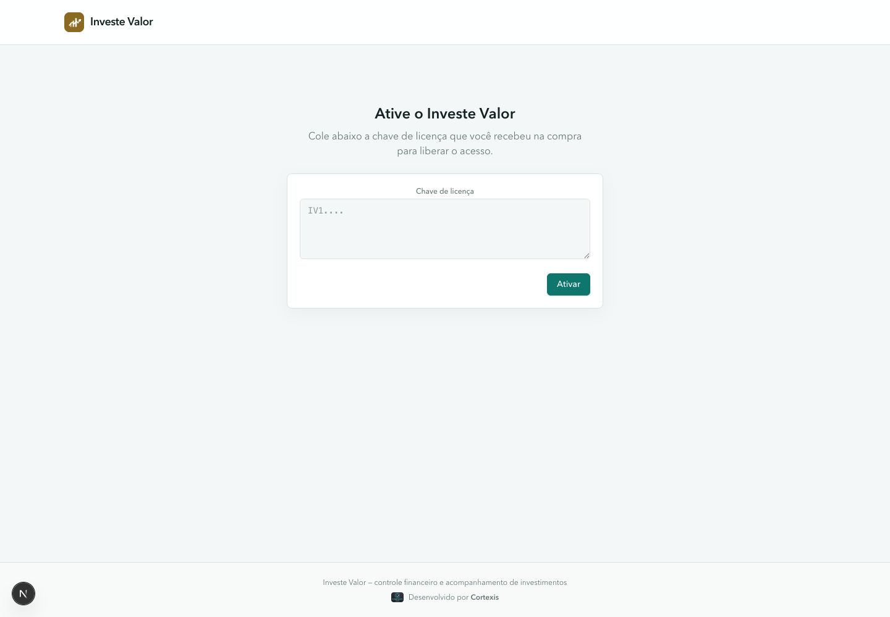

Cole no campo a chave que você recebeu na compra — uma string longa começando com `IV1.` — e clique em **Ativar**. A validação acontece localmente, sem precisar de internet, e a chave fica guardada na sua instalação: você só precisa ativar uma vez.

Se a chave for inválida, estiver expirada, ou não tiver sido informada ainda, o app volta para essa tela e bloqueia o acesso a todas as demais áreas. Depois de ativado, os dados da licença (nome, e-mail e validade) ficam visíveis na aba [Configurações](#14-configurações).

## 3. Criar sua conta e entrar

Depois de ativar a licença, o Investe Valor pede uma conta local — separada da chave de licença — para proteger o acesso aos seus dados dentro da instalação.

### Na primeira vez (nenhuma conta ainda)

O app leva direto para **Criar conta local**: informe um e-mail e uma senha (mínimo de 8 caracteres) e confirme a senha. Essa é a única conta local desta instalação — o Investe Valor não foi feito para múltiplos usuários no mesmo banco de dados.

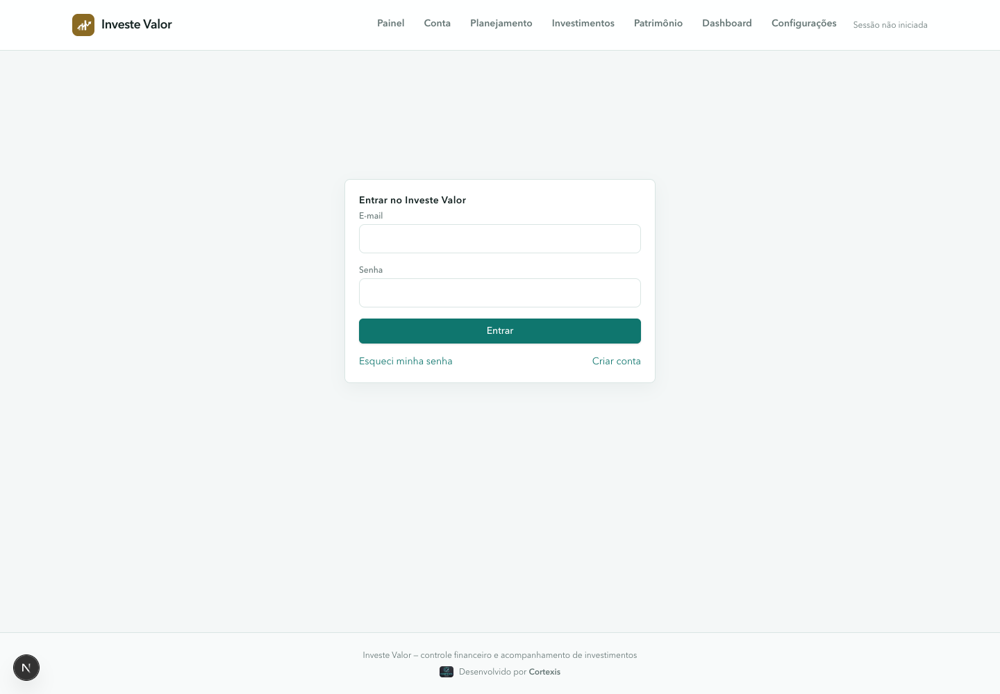

### Nas próximas vezes

Você cai na tela **Entrar**, com e-mail e senha. Um link **Esqueci minha senha** dispara um e-mail de redefinição, caso o envio de e-mail esteja configurado nesta instalação (veja o README do projeto). Se você ativou a verificação em duas etapas (veja [Configurações](#14-configurações)), um campo extra pede o código de 6 dígitos do seu aplicativo autenticador antes de liberar o acesso.

A sessão fica salva no navegador; use **Sair**, no menu com seu e-mail no canto superior direito, para encerrá-la manualmente.

## 4. Mantendo o app rodando

Como o Investe Valor chegou até você determina como ele é aberto no dia a dia:

### Se você recebeu um instalador (.dmg no Mac ou .exe no Windows)

É um programa comum: abra a partir do Launchpad/Aplicativos (Mac) ou do menu Iniciar (Windows), como qualquer outro programa do computador. Não precisa de terminal, não precisa manter nada rodando em segundo plano — feche a janela quando terminar e abra de novo quando quiser voltar. Os dados e a ativação ficam salvos no computador entre uma abertura e outra.

Na primeira vez que abrir um instalador não assinado digitalmente, o sistema operacional avisa antes de deixar abrir (isso é normal, não é vírus):

- **Windows**: SmartScreen mostra "Windows protegeu seu PC" — clique em **Mais informações** e depois **Executar assim mesmo**.
- **Mac**: Gatekeeper recusa abrir de primeira ("desenvolvedor não identificado") — vá em **Ajustes do Sistema → Privacidade e Segurança**, encontre o aviso sobre o Investe Valor e clique em **Abrir Assim Mesmo**.

### Se você instalou via terminal (Node.js)

O comando `npm run start` mantém o Investe Valor no ar enquanto a janela do terminal ficar aberta. Fechar essa janela, ou desligar o computador, derruba o servidor — nada é perdido (a ativação e os dados continuam salvos), mas é preciso rodar `npm run start` de novo antes de usar o app.

### Uso ocasional

Se você usa o app só de vez em quando, isso já é suficiente: abra o terminal, rode `npm run start`, acesse `http://localhost:3000` no navegador, e feche a janela do terminal quando terminar.

### Uso contínuo (recomendado para uso diário)

Para deixar o Investe Valor sempre disponível em segundo plano, sem precisar manter uma janela de terminal aberta, use o [pm2](https://pm2.keymetrics.io/), um gerenciador de processos gratuito:

```bash
npx pm2 start npm --name investe-valor -- start
```

Isso inicia o app em segundo plano. Comandos úteis:

| Comando | O que faz |
|---|---|
| `npx pm2 status` | Mostra se o app está rodando |
| `npx pm2 logs investe-valor` | Mostra o que está acontecendo (útil para diagnosticar problemas) |
| `npx pm2 restart investe-valor` | Reinicia o app |
| `npx pm2 stop investe-valor` | Para o app |

Para o app voltar a rodar sozinho depois que o computador reiniciar:

```bash
npx pm2 startup
npx pm2 save
```

O primeiro comando imprime uma instrução que varia conforme o sistema operacional — copie e rode exatamente o que ele mostrar na tela. O segundo comando salva a configuração atual para ser restaurada no próximo boot.

> Isso é opcional. Sem o pm2, o app funciona normalmente — só exige manter o terminal aberto enquanto estiver em uso.

## 5. Segurança dos dados

O Investe Valor grava os campos sensíveis do seu cadastro cifrados com **AES-256-GCM** antes de tocar o banco de dados. Quem tiver acesso direto ao arquivo do banco, sem a chave de criptografia, não consegue ler esses valores:

- **Investimentos**: nome, instituição, taxa, valor investido e observações.
- **Contas** (Conta): nome, instituição, saldo inicial e limite do cartão.
- **Movimentações** (Conta): valor, descrição, observações e tags.
- **Planejamento**: valor das recorrências e descrição, teto dos orçamentos, e nome/valores das metas.
- **Patrimônio**: saldo, aportes e retiradas de cada lançamento mensal.

Ficam em texto plano os campos estruturais de baixa sensibilidade isoladamente — tipo, indexador, datas, liquidez, cobertura do FGC, tipo de conta/movimentação, dia do mês da recorrência, nome das categorias (Moradia, Alimentação...), e a instituição/aplicação de cada linha do Patrimônio (usadas para localizar e atualizar o lançamento certo) — usados para filtrar, ordenar e destacar vencimentos na tela.

> Uma conta ou movimentação criada em uma versão anterior do app (antes de um campo passar a ser cifrado) continua funcionando normalmente: na primeira vez que a tela é aberta, o valor é lido, cifrado e regravado automaticamente — não é preciso fazer nada.

> A chave de criptografia (`ENCRYPTION_KEY`) é configurada por quem instala e roda a aplicação — veja as instruções no README do projeto. Guarde-a com cuidado: **sem ela, os dados já salvos ficam irrecuperáveis**; se ela vazar, quem a tiver consegue decifrar esses dados.

## 6. Painel

É a tela inicial (`/`) — o resumo do seu dia a dia financeiro, pensado para ser consultado (e atualizado) várias vezes por semana.

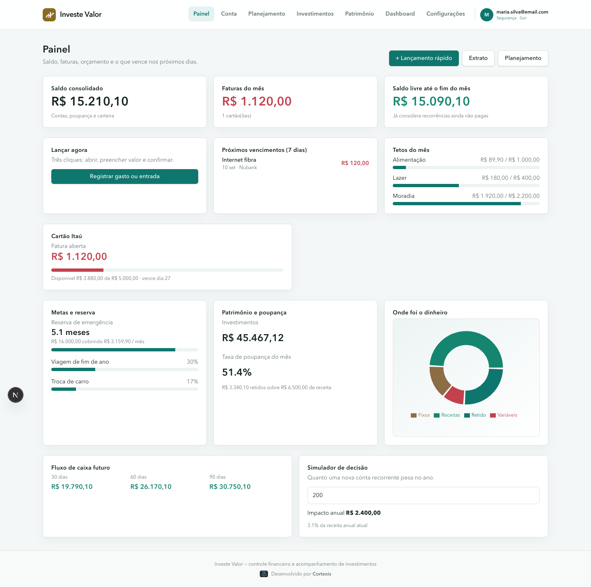

- **Saldo consolidado** — soma de todas as contas correntes, poupanças e carteiras (não inclui cartão de crédito).
- **Faturas do mês** — soma das faturas abertas de todos os cartões de crédito cadastrados.
- **Saldo livre até o fim do mês** — saldo atual somado às receitas e subtraído das despesas recorrentes que ainda vão ocorrer neste mês.
- **+ Lançamento rápido** — abre um formulário compacto para registrar uma despesa, receita ou transferência em poucos cliques, sem sair do Painel.
- **Próximos vencimentos (7 dias)** — recorrências e parcelas que vencem na semana.
- **Tetos do mês** — barra de progresso do gasto de cada categoria com orçamento definido em [Planejamento](#7-planejamento).
- **Cartões** — um cartão por cada cartão de crédito cadastrado, com fatura aberta, limite disponível e dia de vencimento.
- **Metas e reserva** — termômetro de quantos meses de custo de vida a sua reserva de emergência cobre, e progresso de cada caixinha/objetivo.
- **Patrimônio e poupança** — total investido (módulo de Investimentos) e taxa de poupança do mês (percentual da renda líquida retido).
- **Onde foi o dinheiro** — gráfico com a distribuição da receita entre gastos fixos, variáveis e valor retido no mês.
- **Fluxo de caixa futuro** — saldo projetado para os próximos 30, 60 e 90 dias, considerando as recorrências ativas.
- **Simulador de decisão** — mostra quanto uma nova despesa recorrente (ex.: uma assinatura) pesaria no ano e qual percentual da sua renda anual ela representa.

## 7. Conta

Extrato completo das suas contas e cartões (`/conta`).

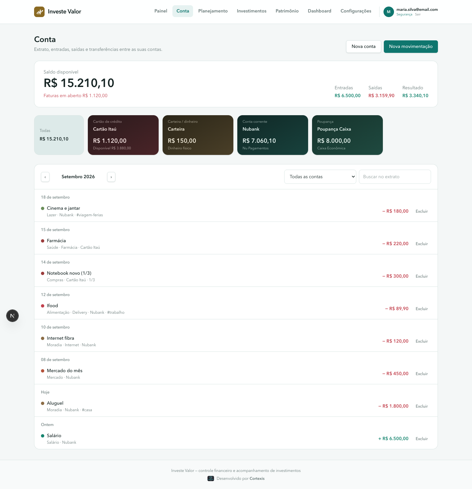

- **Nova conta** — cadastre contas correntes, poupanças, carteiras (dinheiro físico ou carteira digital) ou cartões de crédito. Para cartões, informe limite, dia de fechamento e dia de vencimento.
- **Cartões de conta** — no topo da tela, cada conta aparece como um cartão com o saldo (ou, no caso de cartão de crédito, o limite disponível). Clique em um cartão para filtrar o extrato só daquela conta, ou em **Todas** para ver o consolidado.
- **Nova movimentação** — registra uma entrada, saída ou transferência. No formulário:
  - **Categoria e subcategoria** — categoria principal (ex.: Moradia) e, opcionalmente, uma subcategoria (ex.: Internet).
  - **Tags** — texto livre separado por vírgula, para agrupar gastos que atravessam categorias (ex.: `viagem-ferias, trabalho`).
  - **Parcelas** — para despesas no cartão, informe o número de parcelas; o sistema cria automaticamente uma movimentação por mês, cada uma com sua data de vencimento.
  - **Transferência** — escolha a conta de origem e a de destino; a movimentação aparece nas duas contas.
- Use a busca e o filtro de mês para navegar pelo histórico. Cada movimentação pode ser editada ou excluída clicando nela.

## 8. Planejamento

Onde você define os limites e as recorrências que alimentam o Painel (`/planejamento`).

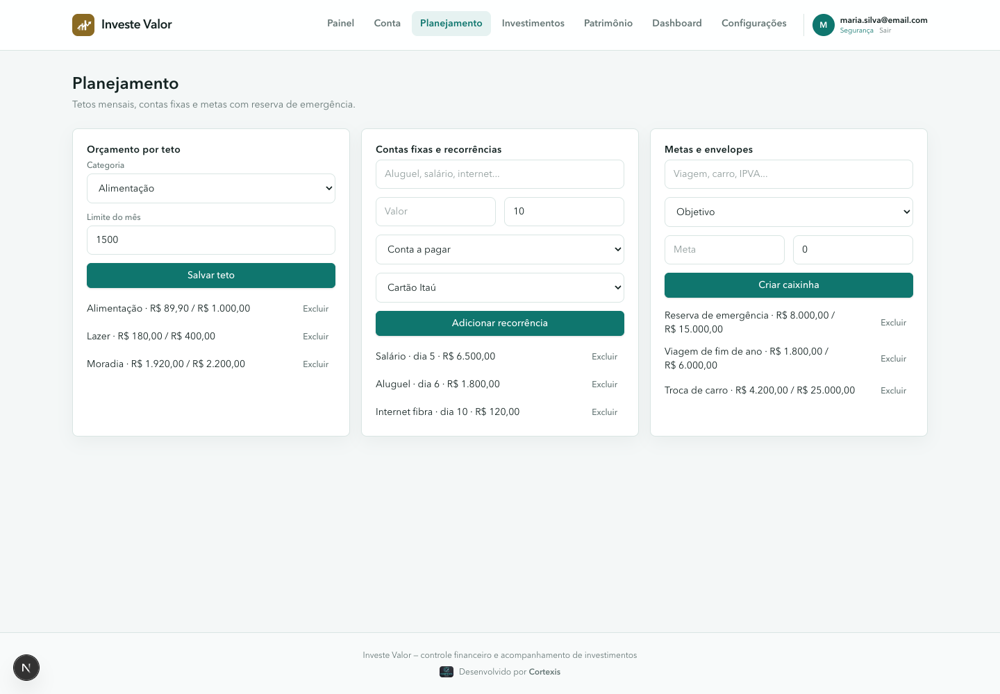

- **Orçamento por teto** — escolha uma categoria e um valor limite para o mês corrente. O Painel mostra o gasto acumulado contra esse teto em tempo real.
- **Contas fixas e recorrências** — cadastre uma despesa ou receita que se repete todo mês, informando a descrição, o valor, o dia do mês e a conta. O sistema gera automaticamente os vencimentos futuros (usados no Painel e na projeção de fluxo de caixa).
- **Metas e envelopes** — crie uma caixinha do tipo **Objetivo** (ex.: viagem, troca de carro, IPVA/IPTU) ou **Reserva de emergência**, com valor-alvo e valor já guardado. Atualize o valor guardado sempre que fizer um aporte à meta.

## 9. Investimentos

Aqui você cadastra, edita e remove cada aplicação. A tabela já mostra o valor estimado de cada linha, atualizado a cada visita.

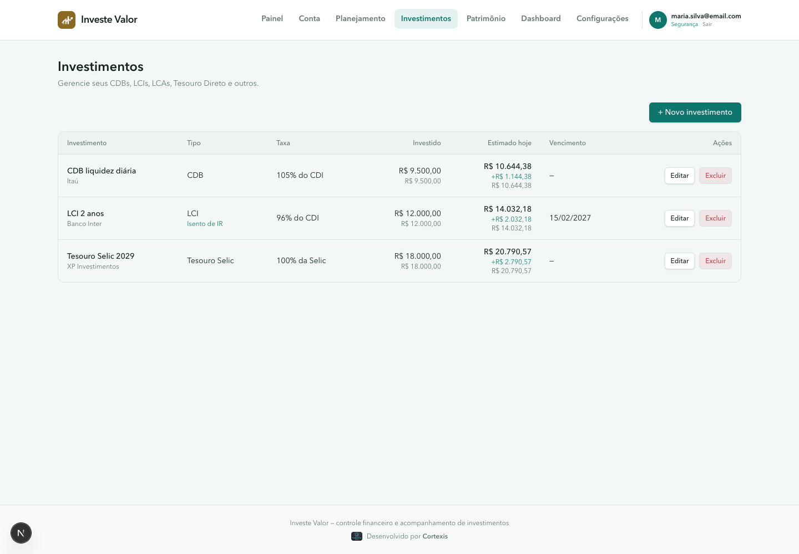

### Adicionar um investimento

Clique em **+ Novo investimento** e preencha o formulário. Ao escolher o **Tipo**, o campo Indexador já vem pré-selecionado com o mais comum para aquele tipo — mas pode ser trocado livremente.

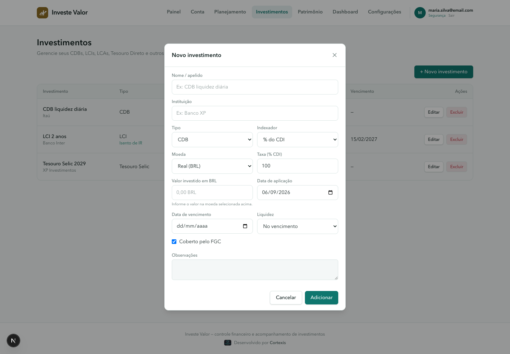

| Campo | Descrição |
|---|---|
| Nome / apelido | Identificador livre para reconhecer a aplicação na lista. |
| Instituição | Banco, corretora ou cooperativa onde o investimento foi feito. |
| Tipo | CDB, LCI, LCA, LC, Tesouro Selic, Tesouro Prefixado, Tesouro IPCA+, Poupança ou Outro. Define se há isenção de IR. |
| Indexador | % do CDI, % da Selic, IPCA + spread fixo, ou taxa Prefixada. |
| Taxa | O número contratado, no formato do indexador — ex: `105` para 105% do CDI, `6,2` para IPCA + 6,2% a.a. |
| Valor investido | O principal aplicado na moeda escolhida: BRL, USD ou EUR. |
| Moeda | Moeda do valor informado: Real (BRL), Dólar (USD) ou Euro (EUR). O valor digitado pertence à moeda escolhida. |
| Data de aplicação | Quando o dinheiro foi investido; ponto de partida do rendimento. |
| Data de vencimento | Opcional — deixe em branco para liquidez diária sem vencimento fixo. |
| Liquidez | Diária ou no vencimento (informativo). |
| Coberto pelo FGC | Marque se o investimento tem garantia do Fundo Garantidor de Créditos. |
| Observações | Campo livre para anotações. |

### Editar ou excluir

Na tabela, use **Editar** para abrir o mesmo formulário já preenchido, ou **Excluir** para remover a aplicação — a exclusão pede confirmação, pois não pode ser desfeita.

| Editar | Confirmar exclusão |
|---|---|
| 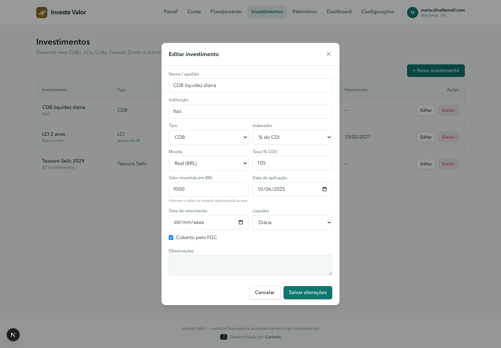 | 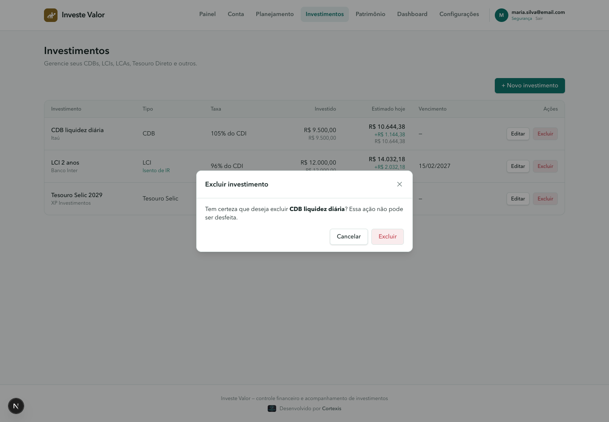 |

## 10. Patrimônio

Patrimônio é a área operacional para acompanhar a planilha mensal. Ela trabalha com uma linha para cada combinação de **instituição + aplicação**, com valores de janeiro a dezembro e o saldo do ano anterior como base de janeiro.

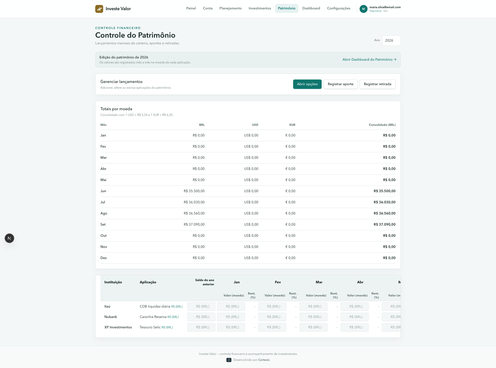

### Adicionar uma aplicação

Em **Adicionar lançamento**, informe a instituição, a aplicação ou conta, a moeda e o mês inicial. A moeda pode ser BRL, USD ou EUR. Os valores mensais dessa linha são registrados na moeda escolhida.

### Aportes e retiradas

Use **Movimentar patrimônio** e escolha **Aporte em aplicação existente** ou **Retirada de aplicação existente**. Selecione a aplicação, o mês e o valor. O sistema usa automaticamente a moeda da linha.

O aporte ou a retirada altera o saldo do mês, mas não é tratado como rentabilidade. A fórmula mensal é:

```text
Rentabilidade = (Saldo atual - Saldo anterior - Aportes + Retiradas) / Saldo anterior
```

### Alterar ou excluir lançamentos

Use as caixas **Alterar lançamento** ou **Excluir lançamento**. Alterar permite mudar instituição, nome e moeda da linha. Excluir remove todos os meses daquele lançamento após confirmação.

### Importar a planilha

Clique em **Selecionar .xlsx** e escolha a planilha com abas anuais, como `2024`, `2025` e `2026`. Os valores são importados como BRL por padrão; depois você pode alterar a moeda da linha.

## 11. Dashboard do Patrimônio

O Dashboard é a área de leitura consolidada dos dados lançados em Patrimônio. Ele possui filtros por ano, instituição e moeda e mostra evolução mensal, composição por moeda, concentração por instituição e posições detalhadas.

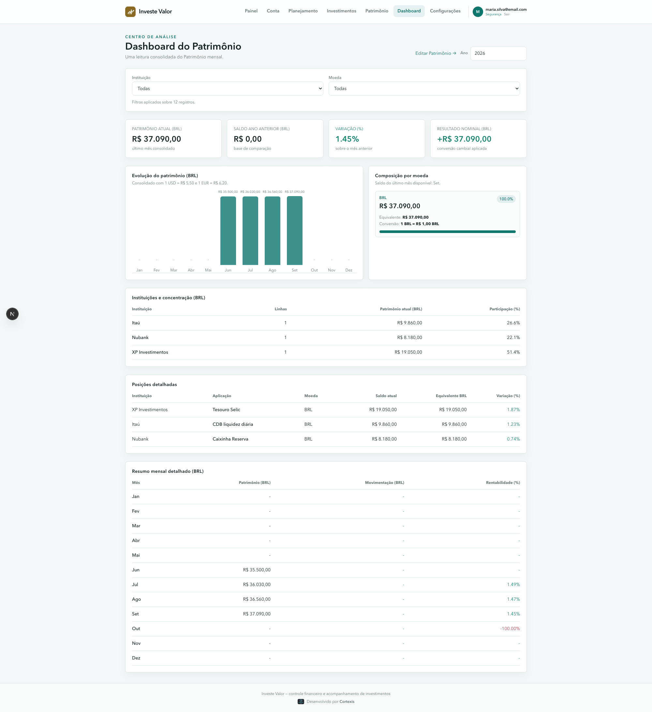

Os totais consolidados são sempre exibidos em BRL. Os valores originais continuam visíveis na moeda da aplicação.

Para USD e EUR, a conversão usada é:

```text
Valor em BRL = Valor na moeda original x Fator de conversão
```

Exemplo:

```text
USD 10.000 x 5,50 = BRL 55.000
```

O Dashboard mostra o fator usado em cada cartão da composição por moeda. Os fatores são alterados em **Configurações**.

## 12. Tipos e indexadores

O tipo escolhido determina, sobretudo, se o investimento paga Imposto de Renda.

| Tipo | IR | Observação |
|---|---|---|
| CDB | Tributado | Geralmente % do CDI, mas pode ser prefixado ou IPCA+. |
| LCI | **Isento** | Letra de Crédito Imobiliário. |
| LCA | **Isento** | Letra de Crédito do Agronegócio. |
| LC | Tributado | Letra de Câmbio, emitida por financeiras; segue a tabela do CDB. |
| Tesouro Selic | Tributado | Pós-fixado, alta liquidez — indicado para reserva de emergência. |
| Tesouro Prefixado | Tributado | Taxa de juros fixa conhecida desde a compra. |
| Tesouro IPCA+ | Tributado | Paga inflação + taxa fixa; protege o poder de compra. |
| Poupança | **Isento** | Regra própria (TR + 0,5% a.m.); aproximada aqui pelo indexador Prefixado — ajuste a taxa manualmente para refletir o rendimento real. |

| Indexador | Como a taxa é lida | Exemplo |
|---|---|---|
| % do CDI | Percentual do CDI vigente informado em Configurações | `105` → 105% do CDI |
| % da Selic | Percentual da taxa Selic vigente | `100` → 100% da Selic |
| IPCA + | Spread fixo somado à inflação projetada | `6,2` → IPCA + 6,2% a.a. |
| Prefixado | Taxa anual fixa | `12,5` → 12,5% a.a. |

## 13. Como o cálculo funciona

O valor estimado de cada investimento é recalculado toda vez que você abre a tela, com base na data de hoje (ou na data de vencimento, se ela já tiver passado).

**1. Rendimento bruto** — o período entre a aplicação e hoje é convertido em dias úteis (aproximando pela proporção de 252 dias úteis por ano) e a taxa anual equivalente do indexador é capitalizada sobre esse período.

**2. Imposto de Renda** (tabela regressiva, para CDB, LC e Tesouro Direto):

| Prazo | Alíquota |
|---|---|
| Até 180 dias | 22,5% |
| 181 a 360 dias | 20,0% |
| 361 a 720 dias | 17,5% |
| Acima de 720 dias | 15,0% |

**LCI, LCA e Poupança são isentos** — o rendimento é somado ao principal sem desconto de IR.

**3. IOF regressivo** — resgates com menos de 30 dias corridos pagam IOF sobre o rendimento (96% no dia 1, caindo até 0% no dia 30), aplicado antes do IR.

### Fórmulas usadas nos campos

As fórmulas abaixo mostram a lógica usada pelo sistema. Os valores são estimativas e não substituem o extrato da instituição.

**Taxa anual equivalente**

```text
CDI       = (CDI informado / 100) x (taxa do investimento / 100)
Selic     = (Selic informada / 100) x (taxa do investimento / 100)
IPCA      = (1 + IPCA informado / 100) x (1 + spread / 100) - 1
Prefixado = taxa do investimento / 100
```

Para `105` no indexador CDI e CDI de `10,65%`, por exemplo:

```text
Taxa anual = 10,65% x 105% = 11,1825% a.a.
```

**Capitalização no período**

```text
Dias úteis aproximados = dias corridos x (252 / 365)
Fator bruto = (1 + taxa anual) ^ (dias úteis aproximados / 252)
Valor bruto = principal x fator bruto
Ganho bruto = valor bruto - principal
```

**Impostos**

```text
IOF = máximo(0, ganho bruto) x alíquota IOF do dia
Ganho após IOF = ganho bruto - IOF
IR = máximo(0, ganho após IOF) x alíquota IR
Valor líquido = máximo(0, principal + ganho após IOF - IR)
```

LCI, LCA e Poupança não aplicam IR. Perdas não geram IR nem IOF.

**Rentabilidade mensal do Patrimônio**

```text
Fluxo líquido = aportes - retiradas
Rentabilidade = (saldo atual - saldo anterior - fluxo líquido) / saldo anterior
```

Assim, um aporte aumenta o patrimônio, mas não aparece como rendimento. Uma retirada reduz o patrimônio, mas não aparece automaticamente como perda de mercado.

> **Isto é uma estimativa.** O cálculo usa uma aproximação de dias úteis e as taxas de referência informadas em Configurações — confira sempre o extrato oficial da instituição antes de decidir um resgate.

## 14. Configurações

Reúne as premissas de cálculo, a importação/backup dos seus dados e a segurança da conta.

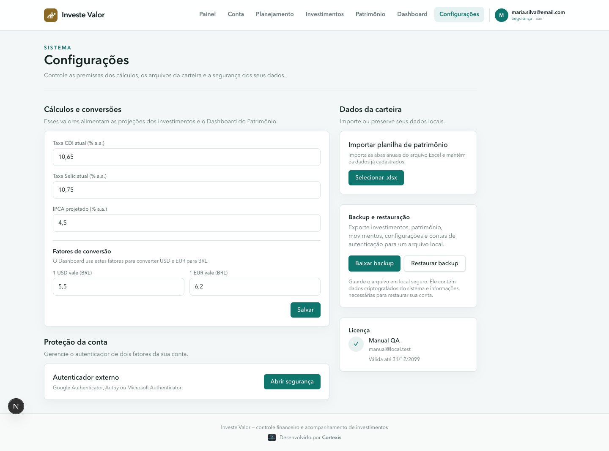

### Cálculos e conversões

- **Taxa CDI atual**, **Taxa Selic atual** e **IPCA projetado** — usadas para projetar o valor estimado dos investimentos indexados. Como o CDI normalmente fica pouco abaixo da Selic, uma atualização vale para toda a carteira de uma vez — não é preciso editar investimento por investimento.
- **1 USD vale (BRL)** e **1 EUR vale (BRL)** — fatores usados para converter investimentos e lançamentos de Patrimônio em dólar/euro para reais.

O Dashboard do Patrimônio usa os valores salvos imediatamente após clicar em **Salvar**, para recalcular os totais consolidados.

### Dados da carteira

- **Importar planilha de patrimônio** — mesmo recurso do botão **Selecionar .xlsx** descrito em [Patrimônio](#10-patrimônio); está disponível aqui também por conveniência.
- **Backup e restauração** — veja a seção seguinte.

### Backup e restauração

- **Baixar backup** — gera e baixa um arquivo `.json` com investimentos, patrimônio, movimentações, contas, orçamentos, metas, configurações e contas de autenticação. Os campos sensíveis saem do arquivo já cifrados, exatamente como estão no banco de dados.
- **Restaurar backup** — abre o seletor de arquivo para escolher um `.json` gerado por **Baixar backup**.

  > **Atenção:** restaurar um backup **substitui todos os dados atuais** da instalação e encerra todas as sessões abertas — não é uma mesclagem. O app pede confirmação antes de prosseguir. Use para migrar de computador ou recuperar de um problema, não para importar dados parciais.

Guarde o arquivo de backup em um local seguro (nuvem pessoal, pendrive, gerenciador de senhas) — ele contém tudo que é necessário para restaurar sua conta em outra instalação, incluindo os dados cifrados. Sozinho, sem a `ENCRYPTION_KEY` da instalação original, o arquivo não é suficiente para ler os dados cifrados nele contidos.

### Proteção da conta (verificação em duas etapas)

Adiciona uma segunda etapa de verificação (TOTP) à sua conta local, além da senha.

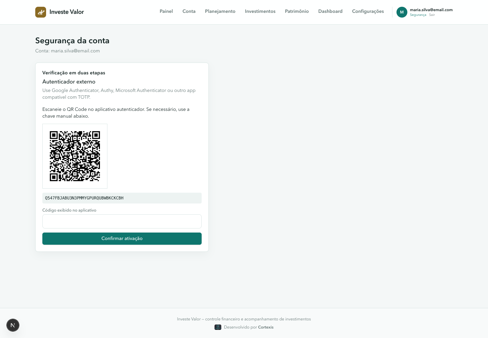

1. Em **Configurações**, clique em **Abrir segurança** (ou acesse pelo menu com seu e-mail, no canto superior direito → **Segurança**).
2. Clique em **Configurar autenticador**.
3. Escaneie o QR Code com Google Authenticator, Authy, Microsoft Authenticator ou outro app compatível com TOTP — ou copie a chave manual mostrada abaixo do QR Code, se preferir digitar.
4. Digite o código de 6 dígitos exibido no aplicativo e clique em **Confirmar ativação**.

A partir daí, todo login pede também esse código (veja [Criar sua conta e entrar](#3-criar-sua-conta-e-entrar)). Para desativar, volte a essa tela, informe o código atual do aplicativo e clique em **Desativar autenticador**.

> Guarde a chave manual (ou um código de backup do próprio aplicativo autenticador) em local seguro. Se você perder o acesso ao aplicativo autenticador e não tiver como gerar o código, não será possível entrar na conta.

### Licença

Mostra nome, e-mail e validade da chave de licença ativada nesta instalação — os mesmos dados codificados na própria chave (veja [Ativação](#2-ativação)).

## 15. Perguntas frequentes

**Perdi minha chave de licença. E agora?**
Fale com quem vendeu o Investe Valor para você — a chave pode ser reenviada a qualquer momento, já que ela não expira sozinha (a menos que tenha sido emitida com validade definida).

**Preciso ativar de novo se eu reinstalar ou trocar de computador?**
Sim. A ativação fica registrada apenas na instalação atual (arquivo `license.key`); reinstalar ou migrar para outra máquina exige colar a chave de novo na tela de ativação.

**Os meus dados ficam salvos onde?**
No banco de dados da própria aplicação, local ao ambiente onde ela está rodando. Nenhuma informação é enviada a bancos, corretoras ou terceiros, e os campos sensíveis ficam cifrados (veja [Segurança dos dados](#5-segurança-dos-dados)).

**O que acontece se eu perder a chave de criptografia?**
Todos os campos cifrados (investimentos, contas, movimentações, orçamentos, metas e patrimônio) ficam irrecuperáveis — a chave não fica salva em nenhum lugar recuperável por design. Guarde-a em um cofre de senhas ou local seguro, separado do banco de dados e do arquivo de backup.

**Como restauro meus dados em outro computador?**
Instale o Investe Valor normalmente, ative com a mesma chave de licença, crie a conta local pedida na primeira tela e, em **Configurações → Restaurar backup**, selecione o arquivo `.json` exportado na instalação anterior. Lembre-se: a restauração substitui os dados da nova instalação pelos do arquivo.

**Perdi o acesso ao meu aplicativo autenticador (2FA). E agora?**
Sem o código de 6 dígitos ou a chave manual salva no momento da ativação, o Investe Valor não tem como verificar sua identidade para desativar a verificação em duas etapas remotamente — é o mesmo princípio da chave de criptografia: a segurança depende de você guardar esses dados. Por isso vale sempre salvar a chave manual (ou os códigos de backup do seu aplicativo autenticador) num local seguro ao ativar.

**Por que o valor estimado muda de um dia para o outro sem eu fazer nada?**
Porque o cálculo usa a data de hoje como referência — a cada dia que passa, mais rendimento é acumulado sobre o principal.

**Posso cadastrar um investimento sem data de vencimento?**
Sim. É o caso comum de Tesouro Selic e CDBs com liquidez diária — deixe o campo em branco.

**O que acontece com o cálculo depois que o investimento vence?**
O Investe Valor trava o rendimento na data de vencimento — ele não continua rendendo indefinidamente depois de vencido.

**Como sei se um investimento é isento de IR?**
A tabela de investimentos mostra a etiqueta "Isento de IR" abaixo do tipo, sempre que o tipo cadastrado for LCI, LCA ou Poupança.
